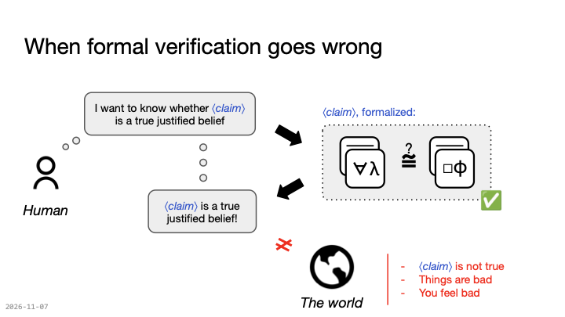

# ACL2 for Trustworthy AI
Jim White <mailto:jim@wiki3.ai>
November 16th, 2026
[20th International Workshop on the ACL2 Theorem Prover
and Its Applications (ACL2-2026)](https://www.cs.utexas.edu/~moore/acl2/workshop-2026/index.html)
Menlo Park, California, USA

https://wiki3-ai.github.io/verified-agent/acl2-trustworthy-ai/slides.html [PDF](slides.pdf)


---


## Douglas Bruce Lenat (September 13, 1950 – August 31, 2023)

# AI has Lost a Giant

Gary Marcus, September 1st, 2023

> Doug Lenat was one of the most brilliant, acerbically funny people I have ever met.  If people like Marvin Minsky, John McCarthy, and Allen Newell were among the first to think deeply about how symbolic AI, in which machines manipulate explicit verbal-like representations, might work, **Doug was the first to try really hard to make it actually work.**  

> Lenat spent the last 40 years of his life launching and directing a project called **Cyc, an intense effort to codify all of common sense in machine-interpretable form. Too few people thinking about AI today even know what that project is.**

https://garymarcus.substack.com/p/doug-lenat-1950-2023  

https://stanfordmag.org/contents/he-taught-ai-the-facts-of-life


---

## Why Do We Need Trustworthy AI?

- **Palantir:** US AI-powered warfare tooling using stale information targeted a school killing more than 150 people, most of whom were children.
*Palantir’s Co-Founder Thinks We Should Be Less Judgmental About That Deadly Iran School Strike* [Mother Jones](https://www.motherjones.com/politics/2026/09/palantirs-co-founder-thinks-we-should-be-less-judgmental-about-that-deadly-iran-school-strike/)

- **Flock:** Flock cameras frequently make false positive identifications which police act upon violating innocent people's rights because they trust the AI system rather than taking it as unverified lead and performing a lawful investigation.
*Dozens of Innocent Motorists Have Been Pulled Over, Detained at Gunpoint, or Jailed Due to AI License Plate Camera Errors* [Institute for Justice](https://ij.org/dozens-of-innocent-motorists-have-been-pulled-over-detained-at-gunpoint-or-jailed-due-to-ai-license-plate-camera-errors/?utm_source=chatgpt.com)

- **ByBit:** The $1.5B Bybit hack was pulled off with supply-chain compromise — a Safe{Wallet} developer was tricked into running malicious software, allowing attackers to inject code that deceived Bybit's signers. [Chainalysis](https://www.chainalysis.com/blog/bybit-exchange-hack-february-2025-crypto-security-dprk/)

- **Binance:** In the $6.3B Binance heist a tampered AI coding tool started the compromise, AI-assisted fake job interviews built trust, and attackers hijacked Binance's own internal AI tool to reach the wallet infrastructure team. [Reuters](https://www.reuters.com/world/binance-says-hackers-used-fake-job-interview-compromise-computer-before-63-2026-11-03/)

- **South Korean banks:** The October 2026 breaches across 16 financial firms (~100,000 customer records) show traces of ARTEX, a free open-source AI penetration-testing agent that autonomously finds and exploits vulnerabilities. [FDD](https://www.fdd.org/analysis/ai-assisted-bank-hacks-expose-a-blind-spot-in-south-koreas-cyber-defenses/)


---


## Software **Is** Speech

This is not the first time fear mongers have instigated government action to violate our rights in America.  

> They can promise strong encryption. They just need to figure out how they can provide us plain text. - FBI General Counsel Valerie Caproni, September 27, 2010

> [W]e're in favor of strong encryption, robust encryption. The country needs it, industry needs it. We just want to make sure we have a trap door and key under some judge's authority where we can get there if somebody is planning a crime. - FBI Director Louis Freeh, May 11, 1995

In the early 90s the US government designated encryption software as a "munition" to be regulated for national security purposes with intensive export restrictions.  EFF represented Daniel Bernstein and got those unconstitutional regulations overturned which paved the way for international e-commerce.

https://www.eff.org/cases/bernstein-v-us-dept-justice

https://www.eff.org/deeplinks/2015/04/remembering-case-established-code-speech


---

## "Slowing Down" Is **Not** An Option

We're at risk for many losses as a consequence of disruptive AI technology (which Andrew Ng called ["The New Electricity" in 2017](https://www.gsb.stanford.edu/insights/andrew-ng-why-ai-new-electricity)), just as we continue to be as a result of other titanic advances in human history such as the discovery of applications of fire, electricity, and nuclear reactions.

Many of these risks are due to the massive technical debt created by humans building computer systems over the last 70 years but **any attempts to "slow down" or regulate progress will only be obeyed by the law-abiding defenders which means the only effect will be to make their ability to counter the attackers slower and less effective.**

Responsible researchers and defenders like OpenAI should, and usually do, take reasonable precautions with time-sensitive vulnerabilities (e.g. cryptography, Linux PE).  Sometimes they also make dumb and expensive mistakes (e.g. Hugging Face hack).

https://openai.com/index/a-thousand-fewer-paths-to-root/

> Clem Delangue asks OpenAI to commit $100 million worth of computing power “to help the Hugging Face community build powerful cyber defenses with the best open and closed models.”
https://techcrunch.com/2026/07/26/hugging-face-ceo-calls-for-radical-transparency-after-unprecedented-openai-hack/

---


## What Does Trustworthy AI Mean?

# Lenat's Last Paper

> **Getting from Generative AI to Trustworthy AI:**
> *What LLMs might learn from Cyc*
> <div class="cite-by">Doug Lenat &amp; Gary Marcus · arXiv:2308.04445 · 2023</div>

[📄 arxiv.org/abs/2308.04445](https://arxiv.org/abs/2308.04445)  [Submitted on 31 Jul 2023]

> AI educated with curated pieces of explicit knowledge and rules of thumb, enabling an inference engine to automatically deduce the logical entailments of all that knowledge.  Even **long arguments produced this way can be both trustworthy and interpretable, since the full step-by-step line of reasoning is always available, and for each step the provenance of the knowledge used can be documented and audited**.

> We suggest that **any trustworthy general AI will need to hybridize the approaches, the LLM approach and more formal approach**, and lay out a path to realizing that dream.


---


# Lenat's Criteria for a Trustworthy AI  (2023)

1. **Justified, not just right** — every answer survives repeated "why?", bottoming out in
   first principles, with a source for each step. *(#1, #12)*
2. **Reasons the way people do** — deduction, induction, abduction, analogy, and contradiction
   detection, at human depth. *(#2–#5)*
3. **Speaks real logic** — quantifier scope and nested modals ("Ukraine hopes that the U.S.
   believes that Putin plans to…") handled without flinching. *(#7, #8)*
4. **Provisional by design** — almost everything is true-by-default; arguments are weighed pro
   and con; new information *retracts* old conclusions, and it tells you. *(#9, #10)*
5. **Situated and bounded** — knows the context, the culture, what *you* already know, its own
   limits, and the contract it is operating under — while being fast, broadly knowledgeable,
   and able to act in the world. *(#6, #11, #13–#16)*

> Lenat & Marcus, *Getting from Generative AI to Trustworthy AI*, arXiv:2308.04445 — 16 desiderata, §2


---


## Lessons from Cyc

### Specification **Is** Hard

> Even with those Cyc-powered KB-building tools, **it has taken a coherent team of logicians and programmers four decades, 2000 person-years, to produce the current Cyc KB**.  Cycorp's experiments with larger-sized teams generally showed a net decrease in total productivity, due to lack of coherence, deeper reporting chains, and so on.

> Given the arduous nature of the reasoning required and the need for tens of millions of general rules of thumb, not just a handful of them, it is understandable **almost all AI researchers and developers have gone in the opposite direction, abandoning or trivializing symbolic representation and reasoning, and instead seeking one or another sort of 'free lunch' in the form of perceptrons, multi-layer neural networks and, most recently, LLMs**.

### Logical Inference with Large World Models Is Slow

> There is however a catch: if the logical language is expressive enough to fully represent the meaning of anything we can say in English, then the inference engine runs much too slowly.


---


## LLMs Make Everything Old New Again

*SIR: A Computer Program for Semantic Information Retrieval* (1964)
https://dspace.mit.edu/entities/publication/441f4bda-eb58-4e51-b070-06d67cf76ca9

*SIXTY YEARS GO BY ... A MIRACLE OCCURS*

*GPT-4* (2023)
https://openai.com/index/gpt-4-research/

Deep Learning, Word2Vec, Transformers, 20T words of naturally occuring human language, and RLHF for instruction following yield a generative model of human language that is adaptable, fluent, persuasive, and creative.  

LLMs go beyond human language models (the first "L" for Large) and incorporate a superhuman level of world knowledge, commonsense, conversational pragmatics, and they're polyglot.

**That means all the computational, mathematical, and AI methods that found effective applications over the decades but were limited by human resources for doing the interpretative and transformative work to use them can be reborn and amplified through automation.**


---

## Generative + Discriminative Systems and RL for Natural Language Processing

The combination of a good generative model with a good discriminative model has repeatedly led to a hybrid model that is better than either alone on NLP problems.  The application of that approach to **reinforcement learning systems that generate code and use verifiable execution have led to rapidly improved performance on historically challenging problems** which have already yielded breakthroughs in math and programming with no end in sight.

*Effective Self-Training for Parsing* (2006) https://aclanthology.org/N06-1020/

*Generative Language Modeling for Automated Theorem Proving* (2020) https://arxiv.org/abs/2009.03393

*DeepSeek-Prover: Advancing Theorem Proving in LLMs through Large-Scale Synthetic Data* https://arxiv.org/abs/2405.14333

*RLEF: Grounding Code LLMs in Execution Feedback with Reinforcement Learning* https://arxiv.org/abs/2410.02089

*DeepSeek-R1: Incentivizing Reasoning Capability in LLMs via Reinforcement Learning* https://arxiv.org/pdf/2501.12948

*On the Navier–Stokes Millennium Prize Problem* https://openai.com/index/navier-stokes-solution/ https://github.com/openai/math

*AlphaProof Code: Verifying Signal’s Security at the Machine-Code Level* 
https://google-deepmind.github.io/code-verification/

---


## Specification Seems Hard

Mike Dodds at [Software Verification in Lean: Palo Alto 2026](https://luma.com/kytl0zlj?tk=7UBDf5)



https://oath.tech/pub/2026/11/specification-seems-hard/

---


## Human Code Review Is Error Prone

Most formal languages have arcane syntax which means humans may easily misinterpret the meaning.

Hallucinated content has a high level of fluency and coherence.
*On Faithfulness and Factuality in Abstractive Summarization*
https://arxiv.org/abs/2005.00661

*FormalRx: Rectify and eXamine Semantic Failures in Autoformalization*
https://arxiv.org/abs/2607.04655


---

## Constructed Natural Languages for Code Review

If we're going to have a lot of human review of formal statements and expressions then improving quality, reducing barriers to entry, and reduing cost will have signifcant value.  Using a constructed langage, which is often English but can be any/all that a reader prefers, a formal language appears in a natural form as they might use when stating the plain meaning of the formal expression.  That will improve accuracy for many humans and perhaps even some LLMs.

*GFLean: An Autoformalisation Framework for Lean via [GF](https://www.grammaticalframework.org/)*
https://arxiv.org/abs/2404.01234

```
Ex. Assume x is an integer, y is an integer and z is an integer. Assume x is even,
y is even and z is not even or x is even, y is not even and z is even or x is not
even, y is even and z is even. Then 3 * x + 5 * y + 7 * z is odd.

example (x : Z) (y : Z) (z : Z) (h158 : ((even x ∧ (even y ∧ (¬ even z))) ∨ ((even x ∧ ((¬
even y) ∧ even z)) ∨ ((¬ even x) ∧ (even y ∧ even z))))) : odd (((3 * x) + (5 * y)) + (7 *
z)) := sorry
```

https://github.com/pkshashank/GFLeanTransfer
https://pkshashank.github.io/

https://github.com/medovina/natural_lean

*Human-in-the-Loop: Legal Knowledge Formalization in Attempto Controlled English* (2025)
https://ieeexplore.ieee.org/document/11011971

*Controlled Language Increases Comprehension of Law for People* (2025)
https://dl.acm.org/doi/10.1145/3711128

*The Pedantic Javadoc Corpus: Comments and Code as Bitext* https://aclanthology.org/2013.bitext-1.6/ [poster](https://drive.google.com/file/d/0B6PL2BdpA2NFeE1KcXVMWE5qaWc/view?usp=sharing&resourcekey=0-0HaoIG-P5nmrV0rOZ5KxVg)

---


## The ACL2 Verified ReAct Agent


```acl2
;;; Sketch
(defun agent-turn-loop (st)
  (declare (xargs :measure (step-quota st)))
  (if (not (should-continue-p st))
      st
    (b* (((mv action tool msg) (call-llm st))
         (next (react-step-with-conversation action tool msg … st)))
      (if (agent-action-case action :tool-call)
          (agent-turn-loop next)
        next))))

(defun do-agent-turn (st input)
  (agent-turn-loop (add-input st input)))
```

An agent loop with correct-by-construction "guardrails" by being implemented in ACL2.

https://github.com/wiki3-ai/verified-agent (December 2025)

**Checks that only permitted actions are allowed but no assurances about the correctness of the outputs, including, or rather *especially, the code***.

TODO: Add support dynamic/extensible/contextual rule (i.e. theorem) sets.


---

## Agent Safety/Security "Guardrail" Business Is Booming

https://genai.owasp.org/resource/ai-security-solutions-landscape-for-agentic-ai-q2-2026/

https://agentsecurityindex.com/

https://bluefolders.ai/insights/the-agentic-unlock

- **Control what an agent can do.** AI Engineer World’s Fair, **Security** track (June–July 2026). Steve Yegge on tool permissions, provenance, and the agent supply chain.
https://snyk.io/lp/snyk-ai-engineer-worlds-fair/

- **Contain failures during execution.** AGNTCon + MCPCon, **Building Reliable Agent Systems** track (October 2026). Guardrails, sandboxing, and recovery. OpenSSF’s workshop applied the Secure Agentic Framework to MCP and Kubernetes. [Track](https://events.linuxfoundation.org/archive/2026/agntcon-mcpcon-north-america/program/explore-the-tracks/) · [Workshop](https://openssf.org/blog/2026/08/27/join-openssf-at-agntcon-mcpcon-north-america-securing-agentic-ai/)

- **Verify who authorized an action.** Cloud Security Alliance, **Verifiable Agent Summit** (November 16, 2026). Verifying agent actions and the authority behind them. 
https://cloudsecurityalliance.org/events/

*Agentic-ZTA: A Multi-Agent Architecture for Autonomous Zero Trust Enforcement*
https://arxiv.org/abs/2610.05782v1

NIST Special Publication 800-207: *Zero Trust Architecture*
https://nvlpubs.nist.gov/nistpubs/specialpublications/NIST.SP.800-207.pdf


---


## A Verified Theorem-Proving Stack

### Milawa - a "self-verifying" theorem prover for an [ACL2](https://www.cs.utexas.edu/~moore/acl2/)-like logic.
https://www.kookamara.com/jared/milawa/index.html

> We begin with a simple proof checker, call it A, which is short enough to verify by the "social process" of mathematics.

> We then develop a series of increasingly powerful proof checkers, call them B, C, D, and so on. We show that each of these is sound: they accept only the same formulas as A. We use A to verify B, and B to verify C, and so on. Then, since we trust A, and A says B is sound, we can trust B, and so on for C, D, and the rest.

> Our final proof checker is really a theorem prover; it can carry out a goal-directed proof search using assumptions, calculation, rewrite rules, and so on. We use this theorem prover to discover the proofs of soundness for B, C, and so on, and to emit these proofs in a format that A can check. Hence, "self verifying."

### Jitawa — a verified Lisp runtime for Milawa on X86
https://www.cl.cam.ac.uk/~mom22/jitawa/

> HOL4-verification of a verified Lisp runtime, called Jitawa. Jitawa was designed to host Jared Davis' Milawa theorem prover — a prover which we have formally proved to be sound when run on Jitawa.


---

## WASM for Trusted Compute (PoCs)

### Milawa runtime on WASM using ECL
https://github.com/jimwhite/acl2/tree/milawa-ecl

### ACL2 runtime on WASM using ECL
https://github.com/jimwhite/acl2/tree/ecl

Run (with a currently small set of books) in the browser (Firefox)
https://jimwhite.github.io/acl2/

### WASM Spec in ACL2 by Ray Myers
https://github.com/raymyers/wasm-acl2
Talk on Tuesday

### WASM Engine correct-by-constuction using [Kestrel ACL2-to-C (ATC)](https://github.com/acl2/acl2/tree/master/books/kestrel/c/atc)
https://github.com/jimwhite/wasm-acl2/tree/main/codegen

### Idea: Automate porting of ACL2 features to Milawa
### Idea: A Jitawa (Verified Milawa Lisp runtime) for WASM
TODO: Volunteers?

### RISC-V is also a good ISA
ACL2 Spec for RISC-V also promising as RISC-V is popular ISA for trusted compute.
https://github.com/acl2/acl2/tree/master/books/kestrel/risc-v


---


## Semantic Web

Beginning in 1998, Sir Tim Berners-Lee led the effort to create a vision for the future of the web which included publishing the Semantic Web manifesto in Scientific American in 2001.  It built on the ideas of Cyc and addressed its shortcomings which included being closed and inside-out/bottom-up (i.e. a classic application of formal methods) rather than decentralized/local-first, and open like the WWW.

RDF, OWL, PROV-O, N3, SPARQL, SHACL, ...

Wikidata.org, dbpedia.org, https://obofoundry.org/

Found significant application in some specialized domains like bioscience, geoscience, fraud detection, and search engines.  Supports interoperability in many more (e.g. SUMO, SBOM).

https://cacm.acm.org/research/a-review-of-the-semantic-web-field/

### Lessons

Open **Is** Better
Specification **Is** Hard

---

## Knowledge Graphs for LLM Reasoning-Acting (ReAct) Agents

GraphRAG uses KG retrieval to improve RAG quality for LLM agent contexts.

LLMs also widely used for constructing and populating KGs.


---

## A Trustworthy Semantic Web Agent

An agent loop which uses transparent and interpretable information in a KG to make verifiably correct decisions and actions.  

Only use language models for natural language to formal language (NL2FL aka autoformalization).  These models can be far smaller than the powerful models used for coding.  They also only need contexts of natural/human size in order to perform local inference necessary for NLU.

Formal methods for validating KG ontology updates from LLM agents.
https://github.com/fabio-rovai/open-ontologies


---

# Thank You

https://wiki3-ai.github.io/verified-agent/acl2-trustworthy-ai/slides.html [PDF](slides.pdf)


<script>
/* Autoscale: shrink any slide whose content overflows the 1280x720 canvas.
   Requires "markdown.marp.html": "all" in VS Code settings (scripts are
   stripped otherwise). Works in preview and in HTML/PDF export. */
(function () {
  var MIN = 0.55;   // never shrink below 55% of the base font size
  var STEP = 0.94;  // shrink ~6% per iteration

  function overflows(section) {
    // scrollHeight includes padding and captures downward overflow.
    // Also catch upward clipping from flex centering (first child above 0).
    if (section.scrollHeight > section.clientHeight + 2) return true;
    var first = section.firstElementChild;
    if (first && first.getBoundingClientRect().top < section.getBoundingClientRect().top - 2) {
      return true;
    }
    return false;
  }

  function fit(section) {
    section.style.fontSize = '';
    var base = parseFloat(getComputedStyle(section).fontSize);
    var size = base;
    for (var i = 0; i < 40 && size > base * MIN; i++) {
      if (!overflows(section)) break;
      size = Math.max(base * MIN, size * STEP);
      section.style.fontSize = size + 'px';
    }
  }

  function run() {
    document.querySelectorAll('section').forEach(fit);
  }

  function start() {
    run();
    // Re-fit once webfonts have settled (metrics change after load).
    if (document.fonts && document.fonts.ready) {
      document.fonts.ready.then(run);
    }
    setTimeout(run, 300);
  }

  if (document.readyState === 'loading') {
    document.addEventListener('DOMContentLoaded', start);
  } else {
    start();
  }
  window.addEventListener('resize', run);
})();
</script>
